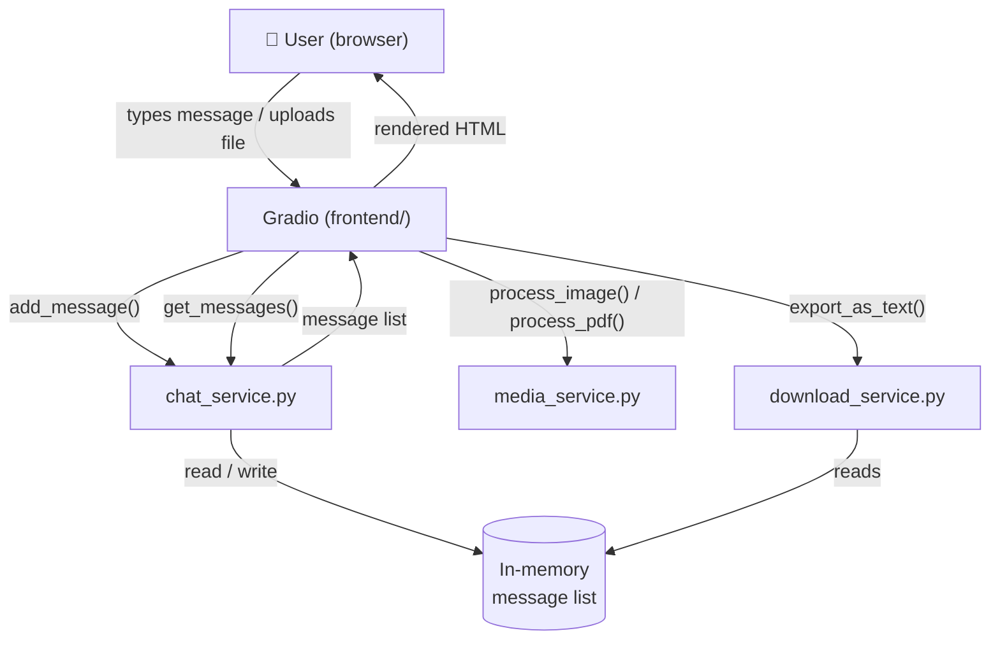

# After Hours Chat — Architecture

> **Status: PROVISIONAL**
> This document describes the *intended* architecture.
> The existing Google Colab application is being migrated incrementally.
> Sections marked **[TO CONFIRM]** will be updated once the original code
> is reviewed and moved into the appropriate modules.

---

## Overview

After Hours Chat is a Netflix-themed, text-only group chat application.
It runs on Google Colab and exposes a public URL through Gradio's built-in
sharing feature (`share=True`). The application is being restructured from
a single-file Colab notebook into a modular Python package.

---

## Component Responsibilities

### `app.py` — Entry Point

- Imports `frontend.layout.build_app()`.
- Calls `app.launch(share=True)` to expose the Gradio public URL.
- Contains no business logic.

---

### `config/settings.py` — Configuration

- Single source of truth for all tuneable constants.
- No imports from `backend/` or `frontend/`.
- Other modules import from here; nothing imports into here.

---

### `backend/` — Business Logic

All modules in `backend/` are pure Python. They do **not** import Gradio
and have no knowledge of the UI.

| Module | Responsibility |
|---|---|
| `chat_service.py` | Owns the shared in-memory message list. Provides `add_message`, `get_messages`, `clear_messages`, `message_count`. |
| `media_service.py` | Validates and processes uploaded files. Returns partial message dicts for image previews and PDF cards. |
| `download_service.py` | Serialises the message list to a downloadable text or HTML file. |
| `user_service.py` | Validates usernames and emoji avatar selections. |
| `timezone_service.py` | Produces timezone-aware formatted timestamp strings using `pytz`. |

---

### `frontend/` — Gradio UI Components

All modules in `frontend/` return Gradio components. They may call
`backend/` functions but the `backend/` must never import from `frontend/`.

| Module | Responsibility |
|---|---|
| `layout.py` | Assembles all sub-components inside `gr.Blocks`. Wires all Gradio event handlers. |
| `chat_ui.py` | Renders the scrollable message history panel. |
| `composer.py` | Provides the text input field and send button. |
| `attachment_ui.py` | Provides the file upload widget. |
| `emoji_picker.py` | Provides the emoji avatar selector. |
| `download_menu.py` | Provides the transcript export download button. |

---

### `static/` — CSS and JavaScript

| File | Purpose |
|---|---|
| `css/main.css` | Netflix-themed base styles and CSS custom properties. |
| `css/chat.css` | Chat bubble, avatar, and media card styles. |
| `css/composer.css` | Input bar and button styles. |
| `css/responsive.css` | Mobile and tablet breakpoints. |
| `js/emoji_picker.js` | Emoji palette toggle and avatar persistence. |
| `js/attachment_menu.js` | Attachment panel toggle and upload feedback. |
| `js/chat_interactions.js` | Auto-scroll, keyboard shortcuts, and optional polling. |

---

## Data Flow



---

## Module Dependency Rules

```
app.py
  └── frontend/layout.py
        ├── frontend/chat_ui.py       → backend/chat_service.py
        ├── frontend/composer.py      → backend/chat_service.py
        │                               backend/user_service.py
        │                               backend/timezone_service.py
        ├── frontend/attachment_ui.py → backend/media_service.py
        ├── frontend/emoji_picker.py  → backend/user_service.py
        └── frontend/download_menu.py → backend/download_service.py
                                        backend/chat_service.py

All modules → config/settings.py
backend/* does NOT import from frontend/*
```

---

## Open Questions [TO CONFIRM]

1. **Message persistence** — Does the existing Colab app persist messages across sessions (e.g., to a file or database), or is the in-memory list the only store?
2. **User identity** — Does the app require a login step, or is the username/emoji chosen per session with no authentication?
3. **PDF rendering** — How are PDF cards rendered in the existing app: as a thumbnail image, an `<iframe>`, or a simple link?
4. **Polling vs. push** — Does the chat panel refresh on a timer (polling) or is it triggered by Gradio events (push)?
5. **Additional dependencies** — Are there any libraries beyond Gradio, Pillow, and pytz in the current Colab notebook?

---

## Migration Plan

1. Share the existing Colab `.ipynb` or `.py` source.
2. Map each code block to its target module using this document.
3. Migrate one module at a time, starting with `backend/chat_service.py`.
4. Activate stub tests (`pytest.mark.skip` → actual assertions) as each module is implemented.
5. Assemble the full UI in `frontend/layout.py` last.
6. Smoke-test by running `python app.py` locally.
